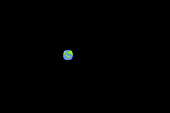

# orbits
An exercise for learning about header files in C++. See instructions [here](./instructions.md)

In my version of orbits, I was inspired by the world's serpent Jörmungandr and wanted to get my snake to orbit arount earth just like how he is said to have done. 

Thus, i created sprites for the snake's head, body and a sprite of the eart as the player.

The implementation ended up being a little wonky as I made new oribters spawn at the last orbiter's previous frame location to make a connected body. First orbiter is the head of the snake, the rest are the body. 

To make it better possibly playing around with the initital implementation of Hooke's law's numbers could help as well as choosing from a richer variety of previous positions of each sprite. 